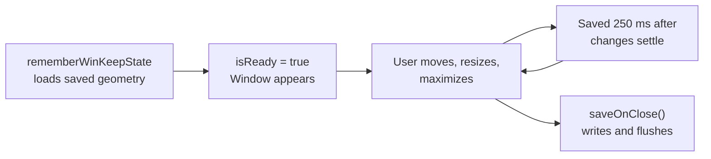

# WinKeep

WinKeep makes Compose Desktop windows reopen with the size, position and placement they had when they were closed.

You keep owning your `Window`. WinKeep loads the saved geometry before the window first appears, saves changes while it is open, and writes the final state when it closes. It supports the classic `androidx.compose.ui.window` API on macOS, Windows and Linux X11.

## WinKeep saves everything a user changes except minimizing

| Saved and restored | Not saved |
| --- | --- |
| Outer size and position of the floating window | Minimized state: a window closed while minimized reopens visible |
| Placement: `Floating`, `Maximized` or `Fullscreen` | Bounds a window had while maximized or fullscreen |
| The monitor the floating window was on | Display scale: WinKeep uses Compose's own coordinates as they are |

A maximized or fullscreen window remembers its floating bounds separately. After a restart it opens maximized or fullscreen again, and returning to floating restores the bounds the user last chose.

## Installation

Add the dependency next to your Compose Desktop runtime:

```kotlin
dependencies {
    implementation("com.prof18:winkeep:<current-version>")
    implementation(compose.desktop.currentOs)
}
```

WinKeep needs Java 17 or newer. It brings Compose runtime and UI and kotlinx.coroutines as API dependencies. Your application supplies the platform graphics runtime, usually `compose.desktop.currentOs`.

Run and package your app on the [JetBrains Runtime](https://github.com/JetBrains/JetBrainsRuntime). It fixes many desktop window bugs that the standard OpenJDK still has, and WinKeep is tested on it. With OpenJDK on Linux, a window restored from minimized or fullscreen can come back taller by its title bar, and WinKeep then saves that size.

## Four steps make a window persistent

```kotlin
@Composable
fun PersistentWindow(
    windowId: String,
    title: String,
    onClosed: () -> Unit,
    content: @Composable FrameWindowScope.(WinKeepState) -> Unit = {},
) {
    val state = rememberWinKeepState(appId = "com.example.myapp", windowId = windowId) // 1
    val scope = rememberCoroutineScope()
    if (state.isReady) { // 2
        Window(
            onCloseRequest = {
                scope.launch {
                    state.saveOnClose() // 3
                    onClosed()
                }
            },
            state = state.windowState,
            title = title,
        ) {
            WinKeepEffect(state) // 4
            content(state)
        }
    }
}
```

1. `rememberWinKeepState` creates the controller for one window and starts loading its saved geometry.
2. Compose the `Window` only once `isReady` is true. This avoids a flash at the default size.
3. Await `saveOnClose()` before the window leaves composition. It writes the final geometry and flushes it to storage.
4. `WinKeepEffect` goes inside the `Window`. It follows moves, resizes and placement changes.

Call it from `application { PersistentWindow("main", "My app", ::exitApplication) }`. The [sample](sample/src/main/kotlin/com/prof18/winkeep/sample/Main.kt) uses the same function for two independent windows.

## Each window has its own saved state

`appId` names your application and `windowId` names one window in it. Use a stable `appId`, such as your package name, and a different `windowId` for every window that should remember its own geometry.

```kotlin
PersistentWindow("main", "My app", onClosed = { mainOpen = false })
PersistentWindow("settings", "Settings", onClosed = { settingsOpen = false })
```

Both IDs must be non-blank and at most 256 Unicode code points. Two windows open at the same time with the same pair of IDs throw `IllegalStateException`.

## Saving happens in the background and on close



Background saves can stay in memory until the system writes them to disk. If the process is killed before a flush, the last changes can be lost. `saveOnClose()` and `save()` both write the current geometry and wait until it is on disk.

| Call | Use it when | Afterwards |
| --- | --- | --- |
| `saveOnClose()` | The window is about to close | WinKeep stops following the window. Later calls return the same result. |
| `save()` | You hide the window instead of closing it, or the app quits from a menu | WinKeep keeps following the window. |

If your app quits with `exitApplication()` from a menu or shortcut, the windows never get `onCloseRequest`. Await `save()` on each open window before you exit.

## Both calls report what happened

`save()` and `saveOnClose()` return a `WindowSaveResult`:

| Result | Meaning |
| --- | --- |
| `Saved` | The geometry was written and flushed. |
| `NothingToSave` | The window was never shown in a state WinKeep could record, so nothing was written. |
| `ReadOnly` | The saved record comes from a newer WinKeep version. WinKeep keeps it untouched and writes nothing. |
| `Failed` | Writing or flushing failed. The details also go to `onError`. |

## Storage problems never stop a window from opening

When loading, saving or reading the screen layout fails, the window still opens with valid geometry. WinKeep reports the failure to `onError` on the UI thread:

```kotlin
val state = rememberWinKeepState(
    appId = "com.example.myapp",
    windowId = "main",
    onError = { error -> logger.warn("Window state ${error.operation} failed", error.cause) },
)
```

| `error.operation` | What failed |
| --- | --- |
| `Load` | Reading the saved record, or the record has a newer format |
| `Decode` | The default store found a damaged record. The window opens at the default size. |
| `Screens` | Looking up the monitors. The window opens at the default size, and the platform chooses the position. |
| `Save` | Writing a snapshot |
| `Flush` | Waiting for the write to reach disk |

Cancellation is never reported as an error. After a failed background save, WinKeep writes the next change again.

## A window always reopens fully on screen

WinKeep fits the saved window into the usable area of one monitor, which excludes the taskbar, dock and menu bar:

1. WinKeep first looks for the monitor that the window was saved on.
2. If that monitor is gone, WinKeep picks the monitor that overlaps the saved bounds most, and then the default screen.
3. WinKeep shrinks the window when it is larger than the usable area of that monitor.
4. WinKeep moves the window until all of it is visible, so a window that was partly off screen comes back fully visible.

If a monitor moved, the window keeps its offset from that monitor's corner. Positions can be negative on monitors left of or above the primary one.

On Linux X11, a window can grow by its decoration insets right after it appears. WinKeep sets a restored floating window back to its saved size once, so it does not grow on every launch.

Linux window managers can also bring a window back from maximized or fullscreen at another size, often the whole usable screen. For a short moment after the window becomes floating again, WinKeep puts the size and position it had before back on the window.

## Options are read once per window

```kotlin
rememberWinKeepState(
    appId: String,
    windowId: String,
    defaultSize: DpSize = DpSize(800.dp, 600.dp),
    minimumSize: DpSize = DpSize.Unspecified,
    store: WindowStateStore? = null,
    onError: (WindowPersistenceError) -> Unit = {},
)
```

| Parameter | Effect |
| --- | --- |
| `defaultSize` | Size on the first launch, or when no valid record exists. The platform chooses the position. |
| `minimumSize` | Raises restored and default sizes to at least this size, before fitting them to the screen. A screen smaller than the minimum still wins. |
| `store` | Where geometry is kept. `null` uses the default Java Preferences store. |
| `onError` | Receives storage and screen failures. It can change on every recomposition. |

WinKeep reads `defaultSize`, `minimumSize` and `store` only when it creates the state for an `appId` and `windowId` pair. Changing them later has no effect on that window.

`minimumSize` does not stop the user from making the window smaller. Set the AWT minimum on the window as well:

```kotlin
Window(state = state.windowState, onCloseRequest = { /* … */ }) {
    LaunchedEffect(Unit) { window.minimumSize = Dimension(360, 294) }
    WinKeepEffect(state)
}
```

## The default store keeps one record per window in Java Preferences

`PreferencesWindowStateStore` writes one small JSON record per window to Java Preferences, under a node path built from hashes of the two IDs. You cannot find that node by hand, so reset a window through the store:

```kotlin
PreferencesWindowStateStore("com.example.myapp", "main").clear()
```

Call `clear()` before the window's state is created, or after its `saveOnClose()` has finished. If the window is still open, its next save writes the record again.

## A custom store keeps geometry anywhere else

Implement `WindowStateStore` and pass it as `store`. Each store instance holds the record of one window. This in-memory store is useful for tests and previews:

```kotlin
class InMemoryWindowStore : WindowStateStore {
    private var snapshot: WindowSnapshot? = null

    override suspend fun load(): WindowSnapshot? = snapshot

    override suspend fun save(snapshot: WindowSnapshot) {
        this.snapshot = snapshot
    }

    override suspend fun flush() = Unit

    override suspend fun clear() {
        snapshot = null
    }
}

val store = remember { InMemoryWindowStore() }
val state = rememberWinKeepState("com.example.myapp", "main", store = store)
```

Wrap the store in `remember`, because WinKeep keeps the first instance it receives for that window. Your `load` returns `null` when nothing is saved. A store backed by real storage must make `flush` wait until earlier saves are durable, and must throw when a call fails. WinKeep runs every store call off the UI thread and never runs two at once.

## Limitations

- WinKeep supports the classic `WindowState` only, not the experimental `window.v2` API.
- Native Wayland sessions cannot set window positions, so WinKeep does not support them.
- On GNOME, a window restored from minimized can come back shifted or resized by its title bar. WinKeep saves the bounds the window comes back with.

## Further reading

| Document | Contents |
| --- | --- |
| [API reference](docs/api.md) | Every public type, its validation rules and threading |
| [Storage and durability](docs/storage.md) | Record format, node path, debounce and flush rules |
| [Platform testing](docs/platform-testing.md) | Native test coverage and the manual checklist per OS |
| [Releasing](docs/releasing.md) | How a version is verified and published |

## Development

```sh
./gradlew -q --console=plain ktlintCheck check compileKotlin :sample:compileKotlin
./gradlew -q --console=plain nativeTest --rerun
./gradlew -q --console=plain :sample:run
```

CI runs the first command, which is the headless gate. That gate includes the binary compatibility check against `api/winkeep.api`, so run `./gradlew updateKotlinAbi` after you change the public API on purpose. The `nativeTest` task opens real windows and needs a live desktop.

## License

WinKeep is licensed under the [Apache License 2.0](LICENSE).
